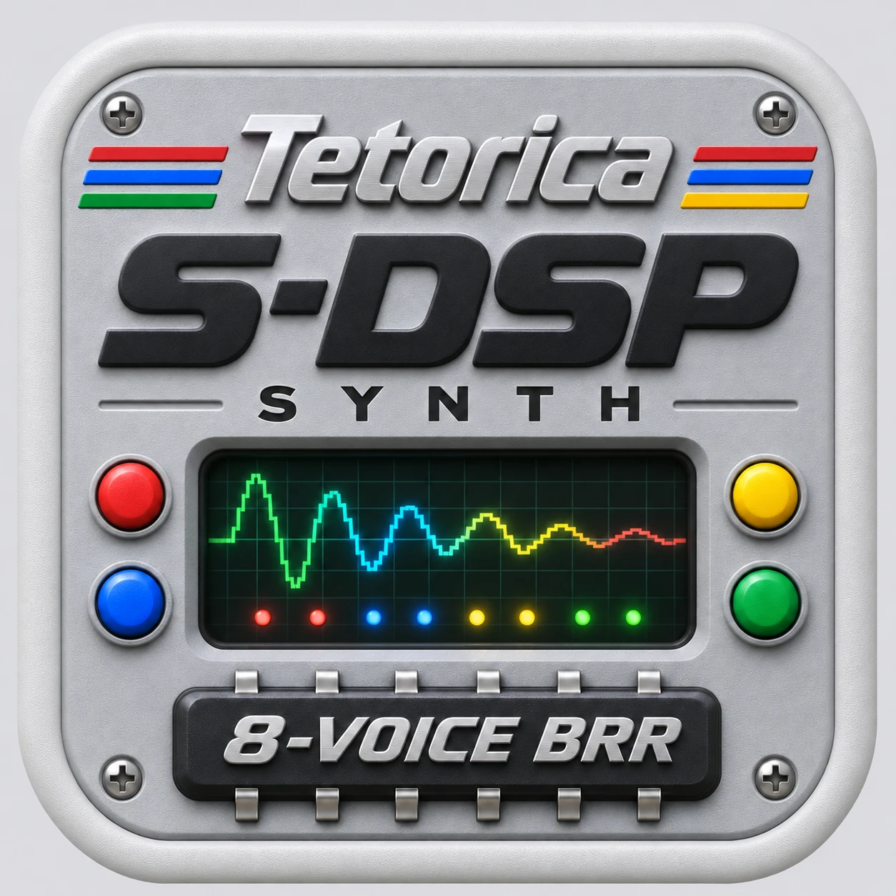

# Tetorica S-DSP Synth — Desktop



Explore SNES S-DSP sound in a Tauri desktop app. This repository wraps
[Tetorica S-DSP Synth](https://kyorohiro.github.io/hello_ymfm_wasm/synth-snes/index.html)
with the Menu, Pin and audio-output controls used by the other Tetorica Synths.

Desktop version **0.0.1** includes **Web Synth 0.0.7**. The original Web release
and every imported file are pinned by SHA-256 in [release.lock.json](release.lock.json).

## Sound and desktop controls

- Eight hardware voices with BRR samples, Gaussian interpolation, signed voice
  volumes and hardware ADSR / GAIN. Draw a wave or load audio / raw BRR.
- Shared hardware Noise clock and Echo / FIR; adjacent-voice PMON uses two
  voices per note for four-note playing, with independent Wave / BRR modulators.
- SPC snapshot instrument extraction, including optional isolated BRR PMON
  pairs and captured Echo settings. This is instrument audition, not song playback.
- Portable v5 presets with embedded samples, compatible v1–v4 imports, readable
  JavaScript export, Master up to 380%, Pitch and Octave.
- **Menu** groups SPC, audio, BRR and preset operations, output selection and
  reload. **Pin** keeps the window on top. Reload asks before discarding edits.

**Web Audio** is the default. **Native (Rust)** sends the same final stereo
Master bus to a CPAL output device. Both modes keep the S-DSP renderer in the
same WASM / AudioWorklet engine; Rust handles device output, Pin and native file
saving. Output changes stop held notes and reset Pitch while retaining the
instrument and both samples. The waveform / spectrum monitor stays on that bus.

See the [included Synth guide](dist/README.md) for controls, RAM budgets,
software authoring features, SPC import scope and hardware limitations.

## Run locally

Install Node.js, Python 3, Rust and the platform's
[Tauri prerequisites](https://v2.tauri.app/start/prerequisites/), then run:

```sh
npm ci
python3 scripts/import_release.py --check
npm test
npm run test:native
npm run dev
```

On Windows, use `python` if Python is not available as `python3`.

For an unsigned macOS app:

```sh
npm run build -- --bundles app --no-sign -- --locked
```

The default local output is
`src-tauri/target/release/bundle/macos/Tetorica S-DSP Synth.app`.
For separate signed Intel and Apple Silicon app / DMG builds, export
`APPLE_SIGNING_IDENTITY`, `APPLE_ID`, `APPLE_PASSWORD` and `APPLE_TEAM_ID`, then
run `sh deploy_mac.sh`. Credentials belong in your environment, outside this repository.

## Inspect and modify the code

Application JavaScript and CSS retain module boundaries, comments and names.
The desktop build does not bundle, minify or obfuscate these sources.

| Location | Purpose |
| --- | --- |
| [dist/synth-snes](dist/synth-snes/) | Readable Synth UI, instrument, BRR / SPC import and PMON code |
| [dist/js](dist/js/) | Reusable JavaScript chip API and runtime dependencies |
| [dist/generated](dist/generated/) | Original generated WASM loader and binary |
| [dist/sources](dist/sources/) | Matching native C++ sources, build recipe and hash receipts |
| [desktop](desktop/) | Menu / Pin, native saving and final-bus audio adapters |
| [src-tauri/src](src-tauri/src/) | Tauri host and CPAL output |

Desktop adapters are injected by the local resource server. Importing a Web
release leaves its browser files unchanged. To edit imported files under
`dist/`, make the changes, record them and check the result:

```sh
npm run record:edits
python3 scripts/import_release.py --check
```

`local-changes.json` records edits over the pinned release while preserving the
original hashes. Importing a new ZIP replaces `dist/`; keep edits in Git before
updating and reapply them afterward.

## Import a Web release

Obtain a readable S-DSP Synth ZIP from the parent project, then run:

```sh
npm run import:release -- /path/to/tetorica_sdsp_synth_VERSION_itch.zip
python3 scripts/import_release.py --check
```

The importer validates archive paths, product identity, readable module
receipts, original browser source archive, WASM / native source receipts and
required license notices before replacing `dist/`. Both `dist/` and
`release.lock.json` belong in Git. `.gitattributes` preserves their bytes on
Windows and other checkout platforms.

## Verification and CI

```sh
npm test
npm run test:browser -- --out artifacts/desktop-browser.json --screenshots artifacts/screenshots
npm run test:audio-transport -- artifacts/audio-transport.json
npm run test:native
cargo fmt --manifest-path src-tauri/Cargo.toml --check
```

Browser checks use real S-DSP WASM and AudioWorklets in Chromium / WebKit with
a mocked Tauri host and muted speakers. Transport stress tests simulate IPC and
device scheduling. Default Rust tests avoid opening an audio device. These
checks do not replace physical-device listening or prolonged WebView playback.

[Build Desktop](.github/workflows/build-desktop.yml) configures macOS Apple
Silicon / Intel, Windows x64 and Linux x64 / ARM64 builds. Main-branch builds
produce workflow artifacts. Tags starting with `v` attach installers to a
**draft** GitHub release. CI builds are unsigned; local `deploy_mac.sh` uses
your exported signing / notarization credentials. Hosted CI results require
pushing the repository.

Current work and manual checks are recorded in [the TODO](docs/todo_20261106.md)
and [verification notes](docs/verification_20261106.md).

## Sources and licenses

The desktop wrapper uses the [BSD 3-Clause license](LICENSE). Imported Synth
modules retain their original notices. The bundled `snes_spc` core is
**LGPL-2.1-or-later**, with its complete matching source and rebuild recipe:

- [SNES SPC sources and rebuilding](dist/sources/SNES-SPC.md)
- [Native source / WASM receipt](dist/sources/SNES-SPC.json)
- [SNES SPC license](dist/licenses/snes-spc/LICENSE)
- [Original browser source archive](dist/sources/sdsp-synth-browser-inputs.zip)

Useful project links:

- [Tetorica and reusable sound-chip APIs](https://github.com/kyorohiro/hello_ymfm_wasm)
- [S-DSP Synth source](https://github.com/kyorohiro/hello_ymfm_wasm/tree/main/docs/synth-snes)
- [Native sound-chip library](https://github.com/kyorohiro/tetorica-soundchip-native)
- [Tauri](https://tauri.app/)

## 日本語

SNESのS-DSPを試奏するTauri版です。Web版0.0.7の可読ソースをそのまま含み、
Menu・Pin・音声出力設定を追加しています。BRR／audio／SPCとPMON pair取り込み、
波形描画、Noise、ADSR／GAIN、Echo／FIR、プリセット保存に対応します。

初期状態はWeb Audioです。Native出力も音源処理は同じWASM／AudioWorkletを使い、
最後のstereo出力をRustからデバイスへ送ります。`dist/`を改造した場合は
`npm run record:edits`で変更を記録できます。

実デバイスでの実聴・長時間動作・各OSの最終確認はTODOを参照してください。
